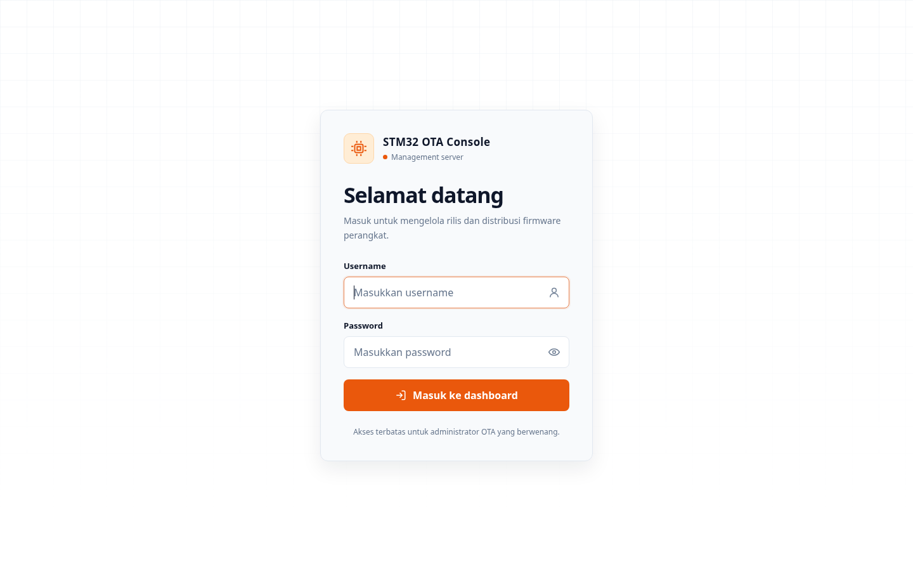
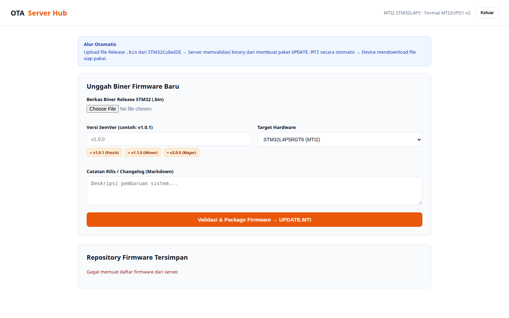

# Demo Dashboard OTA Server

Firmware management backend for IoT microcontrollers. Handles binary uploads, SHA-256 integrity verification, device polling, and versioned update delivery — with Cloudflare Tunnels for public HTTPS access without port forwarding.

---

## Web Interface

### Admin Login



### Dashboard



---

## Features

- Upload Firmware (.bin): Dilengkapi validasi ekstensi file dan penyimpanan aman menggunakan multer.
- SHA-256 Checksum Generator: Otomatis menghasilkan kode hash kriptografi untuk validasi integritas firmware di mikrokontroler.
- Database PostgreSQL: Menyimpan metadata rilis firmware (version, hardware_target, checksum, file_size, release_notes) dan pelacakan perangkat.
- OTA Polling & Download Endpoint: Endpoint khusus bagi perangkat IoT untuk mengecek pembaruan dan mengunduh file biner.
- Live Serial Monitor: Menampilkan log dari masing-masing device secara langsung, lengkap dengan filter device, level, pencarian, jeda, dan pembersihan buffer.

---

## Prerequisites

Pastikan perangkat Anda telah terinstal perangkat lunak berikut:

1. Node.js
2. Docker & Docker Compose

---

## Project Structure

```
dstx-demo-dashboard-ota-server/
├── src/
│   ├── controllers/
│   │   ├── admin_controller.js
│   │   ├── ota_controller.js
│   │   └── serial_controller.js
│   ├── database/
│   │   ├── db.js
│   │   └── init.js
│   ├── middlewares/
│   │   ├── serial_token.js
│   │   └── upload.js
│   ├── routes/
│   │   ├── admin_routes.js
│   │   ├── ota_routes.js
│   │   └── serial_routes.js
│   ├── services/
│   │   └── serial_monitor.js
│   └── utils/
│       └── hash_helper.js
├── storage/
│   └── firmwares/       # Physical .bin file storage
├── .env
├── docker-compose.yml
├── package.json
├── server.js
└── README.md
```

---

## Database Schema

Two tables store firmware metadata and device state.

### `firmwares`

```sql
CREATE TABLE IF NOT EXISTS firmwares (
    id SERIAL PRIMARY KEY,
    version VARCHAR(50) NOT NULL,
    hardware_target VARCHAR(100) NOT NULL,
    file_path VARCHAR(255) NOT NULL,
    file_size INTEGER NOT NULL,
    checksum VARCHAR(255) NOT NULL,
    release_notes TEXT,
    upload_date TIMESTAMP DEFAULT CURRENT_TIMESTAMP
);
```

### `devices`

```sql
CREATE TABLE IF NOT EXISTS devices (
    mac_address VARCHAR(50) PRIMARY KEY,
    current_version VARCHAR(50),
    last_seen TIMESTAMP DEFAULT CURRENT_TIMESTAMP
);
```

Relationship: devices poll `firmwares` for a newer version than `current_version`. A device is identified by its MAC address.

---

## Installation

### 1. Install dependencies

```bash
npm install express multer dotenv pg
npm install --save-dev nodemon
```

### 2. Configure environment

Create `.env` in the project root:

```env
PORT=3100
DB_HOST=localhost
DB_PORT=5433
DB_USER=example_admin
DB_PASSWORD=example_supersecret
DB_NAME=example_database
ADMIN_USERNAME=admin_mertani
ADMIN_PASSWORD=change_this_password
SESSION_SECRET=generate_a_long_random_value
SERIAL_INGEST_TOKEN=generate_a_device_token
SERIAL_LOG_LIMIT=1000
```

### 3. Start PostgreSQL

```bash
docker compose up -d
```

### 4. Initialize database tables

```bash
node src/database/init.js
```

### 5. Start the server

```bash
npx nodemon server.js
```

Server runs at `http://localhost:3100`.

---

## API Reference

### Admin — Firmware Management

**Upload firmware**

```
POST /api/admin/upload
Content-Type: multipart/form-data

### B. OTA API (Untuk Perangkat IoT / STM32)

#### Cek Ketersediaan Update

- Method: `GET`
- URL: `/api/ota/check?devid=1734567890`
- Query wajib: `devid` berupa UNIX ID unik milik device
- Query opsional: `hardware_target` dan `current_version`
- Respons:

```json
{
  "devid": "1734567890",
  "update_id": "1",
  "update_available": true,
  "version": "v2.0.3"
}
```

Jika `current_version` diberikan, `update_available` bernilai `false` ketika versinya sama dengan rilis terbaru. Server hanya memilih firmware yang ditargetkan ke `devid` tersebut atau firmware dengan target `*`.

Setelah server menerima ACK dengan `download_status: true`, pemanggilan check berikutnya mengembalikan `update_available: false` hanya untuk `devid` tersebut. Device lain tetap memiliki statusnya sendiri.

#### Kirim ACK Setelah Download

- Method: `POST`
- URL: `/api/ota/ack`
- Header: `Content-Type: application/json`
- Body:

```json
{
  "devid": "1734567890",
  "update_id": "1",
  "download_status": true
}
```

Nilai `download_status` wajib berupa boolean JSON (`true` atau `false`), bukan string.

#### Unduh Firmware Terbaru

- Method: `GET`
- URL: `/api/ota/download/latest?devid=1734567890`
- Query wajib: `devid`
- Query opsional: `hardware_target`
- Deskripsi: Mengunduh file `.bin` asli hasil compile yang ditargetkan ke device tersebut. Server tidak menambahkan header atau mengubah isi binary.

Saat upload dari dashboard, kolom **Target Device ID** menerima satu atau beberapa `devid` yang dipisahkan koma. Gunakan target `*` hanya bila firmware memang harus tersedia untuk seluruh device.

### Serial Monitor

Halaman monitor tersedia di `http://localhost:3100/monitor` dan dilindungi oleh login admin.

Device mengirim satu log menggunakan endpoint berikut:

```http
POST /api/serial/logs
Content-Type: application/json
X-Device-Token: <nilai SERIAL_INGEST_TOKEN dari .env>
```

```json
{
  "devid": "MTI-0001",
  "level": "info",
  "message": "Boot selesai, sensor siap"
}
```

Nilai `level` yang diterima adalah `debug`, `info`, `warn`, dan `error`. Server menyimpan maksimal `SERIAL_LOG_LIMIT` entri di memori. Buffer log akan kosong ketika proses Node.js dimulai ulang.

Untuk memutar file log secara otomatis dan terus-menerus ke halaman Serial Monitor:

```bash
npm run serial:replay
```

Sumber file, `devid`, interval pengiriman, dan mode pengulangan dapat diatur melalui `SERIAL_LOG_FILE`, `SERIAL_LOG_DEVID`, `SERIAL_REPLAY_DELAY_MS`, serta `SERIAL_REPLAY_LOOP` di `.env`. Tekan `Ctrl+C` untuk menghentikannya. Nilai yang tampak seperti password, token, atau Bluetooth key disamarkan sebelum dikirim.

---

## Public Deployment (Cloudflare Tunnel)

To make the server reachable from IoT devices outside the local network:

```bash
cloudflared tunnel run --url http://localhost:3000 <YOUR_TUNNEL_NAME>
```

Use the resulting HTTPS URL in your microcontroller firmware.

---

## .gitignore

```gitignore
node_modules/
.env
storage/firmwares/*
!storage/firmwares/.gitkeep
.DS_Store
```

---

## Tech Stack

Node.js · Express · PostgreSQL · Docker Compose · Cloudflare Tunnels

## License

MIT
